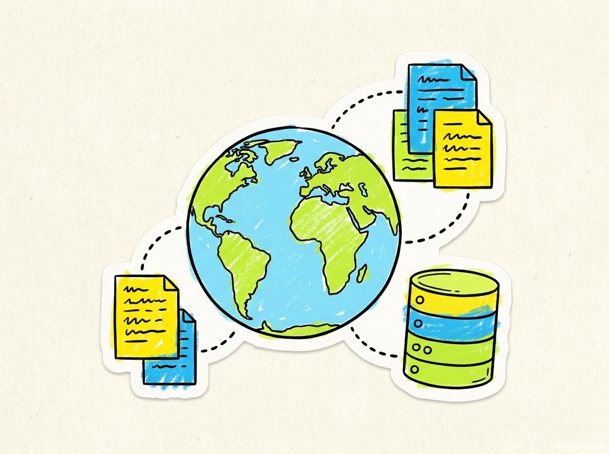

<div align="center">

# ResearchForge

### Verified research and dataset intelligence — built to show its work.

Ask a research question in plain English. ResearchForge searches official public APIs, normalizes the results, verifies identifiers and links, extracts traceable evidence, and clearly says when the evidence is not sufficient.

<p>
  <a href="#quick-start"><strong>Get started</strong></a> ·
  <a href="#how-it-works">How it works</a> ·
  <a href="#api-overview">API</a> ·
  <a href="#honest-limitations">Limitations</a>
</p>


</div>

> [!IMPORTANT]
> **ResearchForge never fabricates sources, citations, dataset counts, findings, experiments, or conclusions.** When it cannot verify enough evidence, it returns: `There is insufficient data worldwide. No dataset.`

## Preview

<div align="center">
  
</div>

ResearchForge is designed as a local-first research workspace: the data, SQLite database, HTTP cache, verification checks, and provenance records stay on your machine. The browser interface is served directly by the FastAPI application with no frontend build step.

## Why ResearchForge?

Most research search tools return a list. ResearchForge builds an auditable chain from **question → source → record → verification → evidence**.

| Capability | What it does |
| --- | --- |
| **Search** | Queries nine official public research APIs through isolated source adapters. |
| **Normalize** | Converts papers and datasets into one consistent record schema. |
| **Deduplicate** | Matches DOI first, then title/year, then high-confidence title similarity. |
| **Verify** | Checks identifiers, metadata, licenses, links, and access state. |
| **Extract evidence** | Stores passages with document IDs, locators, URLs, and retrieval dates. |
| **Find gaps** | Builds an evidence matrix and identifies unsupported areas. |
| **Export** | Produces provenance manifests and manuscript drafts as DOCX, Markdown, TeX, or JSON. |

## Interface tour

<div align="center">

<table>
<tr>
<td width="50%"></td>
<td width="50%"></td>
</tr>
<tr>
<td align="center"><sub>Official source adapters</sub></td>
<td align="center"><sub>Verification before reporting</sub></td>
</tr>
<tr>
<td width="50%"></td>
<td width="50%"></td>
</tr>
<tr>
<td align="center"><sub>Evidence with traceable locators</sub></td>
<td align="center"><sub>Honest insufficient-evidence response</sub></td>
</tr>
</table>

</div>

## Quick start

### Windows

```bat
setup.bat     :: create .venv, install dependencies, create .env, initialize SQLite
run.bat       :: start the server at http://127.0.0.1:8000
test.bat      :: run the unit suite and offline benchmark
```

### Any platform

```bash
python -m venv .venv

# macOS / Linux
.venv/bin/python -m pip install -r requirements.txt
cp .env.example .env
.venv/bin/python -m app.main --no-browser --port 8000

# Windows PowerShell
.venv\Scripts\python.exe -m pip install -r requirements.txt
Copy-Item .env.example .env
.venv\Scripts\python.exe -m app.main --no-browser --port 8000
```

Open [http://127.0.0.1:8000](http://127.0.0.1:8000) after the server starts.

> No API keys are required. Optional credentials can increase rate limits or unlock metadata for selected providers.

## How it works

```text
Natural-language question
          │
          ▼
  Parse + expand terminology
          │
          ▼
  Plan queries per source
          │
          ▼
  Search official public APIs
          │
          ▼
  Normalize → filter → deduplicate
          │
          ▼
  Verify IDs, links, metadata, licenses
          │
          ▼
  Retrieve documents + extract evidence
          │
          ▼
  Sufficiency gate → report or say “not enough evidence”
```

### Source adapters

| Adapter | Source | Coverage |
| --- | --- | --- |
| `openalex` | OpenAlex | Papers and dataset-typed works |
| `crossref` | Crossref | Scholarly literature |
| `semantic_scholar` | Semantic Scholar | Scholarly literature |
| `europepmc` | Europe PMC | Life-science literature |
| `zenodo` | Zenodo | Datasets and papers |
| `datacite` | DataCite | Datasets and research outputs |
| `huggingface` | Hugging Face Hub | Machine-learning datasets |
| `uci` | UCI ML Repository | Machine-learning datasets |
| `datagov` | Data.gov | Government open data |

One adapter failing or being rate-limited never silently blocks the others. The failure is recorded in the search ledger.

## Project structure

```text
app/
├── main.py                 FastAPI application and static frontend
├── config.py               Environment-backed settings
├── db.py                   SQLite schema and connection management
├── api/routes.py           Typed HTTP API
├── sources/                Nine adapters and normalized record schema
└── services/
    ├── orchestration.py    Search → verify → evidence pipeline
    ├── parser.py           Natural-language request parser
    ├── planning.py         Query expansion and source planning
    ├── verification.py     Identifier, link, metadata, and license checks
    ├── evidence.py         Document retrieval and passage extraction
    ├── downloads.py        Resumable downloads and SHA-256 provenance
    ├── manuscript.py       Twelve-section manuscript workspace
    └── store.py             Persistence helpers

app/static/                 No-build vanilla JS frontend and illustrations
tests/                      Offline unit tests and ASGI harness
tools/                      Offline benchmark harness
api/index.py                Vercel Python entrypoint
vercel.json                 Vercel routing configuration
```

## API overview

| Method | Route | Purpose |
| --- | --- | --- |
| `GET` | `/api/health` | Readiness, version, schema, and configuration status |
| `GET` | `/api/meta` | Policies and evidence-sufficiency rules |
| `GET` | `/api/adapters` | Adapter inventory and credential presence |
| `POST` | `/api/research/plan` | Interpret a request without retrieving results |
| `POST` | `/api/research` | Start a background research job |
| `POST` | `/api/research/sync` | Run a research job synchronously |
| `GET` | `/api/jobs/{id}` | Inspect job status |
| `GET` | `/api/projects/{id}/snapshot` | Fetch a complete project workspace |
| `GET` | `/api/records/{id}/evidence` | Read stored evidence passages |
| `GET` | `/api/projects/{id}/manifest` | View the provenance manifest |
| `GET` | `/api/projects/{id}/manuscript/export` | Export DOCX, Markdown, TeX, or JSON |

All API errors use a consistent shape:

```json
{
  "error": {
    "status": 404,
    "message": "record not found",
    "path": "/api/records/123"
  }
}
```

## Configuration

Copy `.env.example` to `.env`. Every setting is optional.

| Variable group | Purpose |
| --- | --- |
| `RF_HOST`, `RF_PORT`, `RF_OPEN_BROWSER` | Server binding |
| `RF_DATA_DIR`, `RF_DB_PATH`, `RF_CACHE_DIR`, `RF_DOWNLOAD_DIR` | Local storage paths |
| `RF_HTTP_TIMEOUT`, `RF_HTTP_MAX_RETRIES`, `RF_HTTP_BACKOFF_BASE` | HTTP resilience |
| `RF_CACHE_TTL_SECONDS`, `RF_MAX_CONCURRENT_REQUESTS` | Cache and concurrency |
| `RF_CONTACT_EMAIL`, `RF_USER_AGENT` | Polite API identification |
| `SEMANTIC_SCHOLAR_API_KEY`, `HUGGINGFACE_TOKEN`, `DATAGOV_API_KEY` | Optional provider credentials |
| `RF_DEFAULT_SEARCH_DEPTH`, `RF_DEFAULT_PAGE_SIZE`, `RF_MAX_RESULTS_PER_SOURCE` | Search defaults |
| `RF_LLM_BASE_URL`, `RF_LLM_API_KEY`, `RF_LLM_MODEL`, `RF_LLM_TIMEOUT` | Optional OpenAI-compatible parser |

Secrets are never returned by `/api/health` or `/api/meta`; those endpoints expose only whether a credential is configured.

## Testing

```bash
python -m unittest discover -s tests -t .
python tools/benchmark.py
```

The regression suite runs fully offline. The benchmark uses documented source-shaped fixtures and checks retrieval, deduplication, metadata accuracy, and unsupported-claim behavior.

Latest verified baseline:

```text
195 tests: PASS
Benchmark: PASS
precision=0.8  recall=1.0  f1=0.8889
metadata_accuracy=1.0  dedupe_pair_recall=1.0  unsupported_claim_rate=0.0
```

## Deploy to Vercel

This repository includes the Python entrypoint at `api/index.py` and routing in `vercel.json`.

1. Push the repository to GitHub.
2. Import `sanyamhbtu/ResearchForge` into Vercel.
3. Keep the project root at the repository root.
4. Add optional environment variables in **Project Settings → Environment Variables**.
5. Deploy and open the generated URL.

The application uses local SQLite and filesystem storage. That works for a local deployment or demo, but Vercel serverless instances are ephemeral. For durable production storage, move the database, cache, and downloads to a managed persistent service before treating the deployment as a multi-user production system.

## Honest limitations

- The benchmark is a small regression corpus, not a claim about internet-wide precision or recall.
- Anonymous public APIs have real rate limits; failures are recorded rather than hidden.
- Coverage is limited to the nine configured sources.
- The deterministic pipeline is the verified default; optional LLM-assisted parsing is not required and is not a source of facts.
- Download and export behavior is covered by tests, while live source coverage varies by provider availability.

## Data and privacy

- Research data is stored locally under `data/` in SQLite with WAL mode.
- The HTTP response cache is local and can be removed without affecting source APIs.
- No telemetry is sent.
- Outbound traffic is limited to configured research APIs and optional LLM endpoints.
- `.env`, `data/`, cache files, downloads, and generated reports should not be committed.

## License

Add your project license here before publishing the repository publicly.

<div align="center">

**ResearchForge** — find real research, prove it, and never fake it.

</div>
